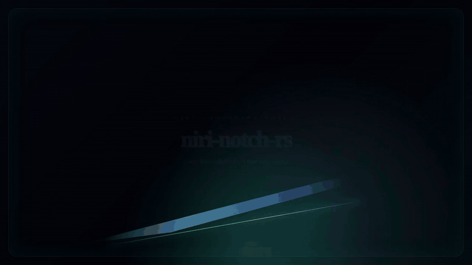

# niri-notch-rs

[](https://github.com/mud-the-developer/niri-notch-rs/actions/workflows/ci.yml)


Animated Dynamic Island-style companion notch for the [Niri](https://github.com/YaLTeR/niri) Wayland compositor.

<p align="center">
  <a href="docs/assets/niri-notch-rs-showcase.mp4">
    
  </a>
</p>

<p align="center">
  <a href="docs/assets/niri-notch-rs-showcase.mp4">Open the 17s Remotion MP4 showcase</a>
</p>

`niri-notch-rs` is a **companion daemon**, not an in-process compositor plugin. It owns a GTK3 + `gtk-layer-shell` overlay surface and integrates with Niri, Waybar, mako, and playerctl through narrow, testable effect boundaries.

## Features

- Top-center animated layer-shell notch.
- Compact and expanded states with damped spring sizing.
- Niri workspace and focused-window context.
- mako notification interception:
  - auto-open on new notification,
  - cache notification text/chip,
  - dismiss duplicate mako card after a short delay.
- playerctl media fallback.
- Mouse interactions:
  - hover opens,
  - left click clears notification or toggles media,
  - right click opens the user's Niri control center,
  - wheel up/down switches Niri workspaces.
- Waybar companion styling pattern: Waybar as left/right secondary rails, notch as primary center surface.
- Testable internals:
  - `src/core.rs`: pure reducer, no I/O,
  - `src/install.rs`: pure Niri config managed-block transforms,
  - `src/main.rs`: GTK UI, snapshot collection, filesystem/process effects.

## CLI

```bash
niri-notch-rs doctor
niri-notch-rs doctor --json
niri-notch-rs install --user --dry-run
niri-notch-rs install --user
niri-notch-rs uninstall --user --dry-run
niri-notch-rs uninstall --user
niri-notch-rs preview
```

`doctor` checks:

- `niri`
- `gtk-layer-shell-0` via pkg-config
- `waybar`
- `makoctl`
- `playerctl`
- Niri config validity
- Niri layer query availability

`install --user` writes an idempotent managed block to `~/.config/niri/config.kdl` and creates a timestamped backup before modifying the file.

## Build

Arch/CachyOS dependencies:

```bash
sudo pacman -S --needed rust gtk3 gtk-layer-shell pkgconf waybar mako playerctl
```

Build and install locally:

```bash
cargo build --release --locked
install -Dm755 target/release/niri-notch-rs ~/.local/bin/niri-notch-rs
~/.local/bin/niri-notch-rs doctor
```

## Niri integration

Manual config example:

```kdl
spawn-sh-at-startup "waybar"
spawn-sh-at-startup "~/.local/bin/niri-notch-rs"
```

Or let the CLI manage the `niri-notch-rs` block:

```bash
niri-notch-rs install --user --dry-run
niri-notch-rs install --user
niri validate -c ~/.config/niri/config.kdl
```

Recommended Waybar setup:

```json
"modules-center": []
```

Then style Waybar as companion rails rather than another strong center island.

## Quality gates

CI and release candidates run:

```bash
cargo fmt -- --check
cargo test --locked
cargo clippy --locked --all-targets --all-features -- -D warnings
RUSTDOCFLAGS="-D warnings" cargo doc --locked --no-deps
cargo build --release --locked
```

## Architecture

```text
Event / snapshot / pointer input
  -> AppEvent
  -> reduce(AppState, AppEvent) -> (AppState, Vec<Effect>)
  -> render AppState
  -> run Effect through a narrow effect runner
```

Install/config changes follow the same rule:

```text
Niri config text + InstallPlan
  -> pure transform
  -> backup + write in the effect layer
```

This keeps desktop behavior testable without GTK, Niri, mako, playerctl, or a live Wayland session.

## Video

A Remotion showcase video lives in:

```text
video/
```

Render it with:

```bash
cd video
npm install --include=dev
npm run typecheck
npm run still
npm run render
```

The composition uses real GitHub and Niri desktop screenshots from the project smoke-test pass.

## Packaging

An Arch packaging draft lives in:

```text
packaging/arch/PKGBUILD
packaging/arch/.SRCINFO
```

## Status

Pre-1.0 daily-driver prototype. Verified locally on CachyOS + Niri + Waybar at 1920x1080@180Hz.
